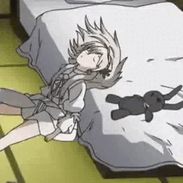

# Hi, I'm enadorry 👋

ものづくりが好きな、えなどりです。  
プログラミング、3DCG、ロボット、AIなど、興味のあることに挑戦しています。

## What I'm interested in

- 🎮 **ゲーム・アプリ開発** — Unityを使った制作
- 🤖 **ロボット・電子工作** — ESP32や基板、制御プログラム
- 🎨 **3DCG・デザイン** — Blenderでのキャラクターや作品づくり
- 🧠 **AI** — ローカルLLMやAIを使ったツール
- 🥽 **AR・VR** — 新しい体験をつくる技術に興味があります

## Projects

- [H2OROBOT](https://github.com/enadorry/H2OROBOT) — 水中ロボットに関するプロジェクト
- [chemistry-pairs](https://github.com/enadorry/chemistry-pairs) — 化学をテーマにした神経衰弱
- [KaimonoScan](https://github.com/enadorry/convenience-store--Barcode) — バーコードを使った買い物アプリ

## Links

- 🌐 Portfolio: [enadorry.dev](https://enadorry.dev)
- 𝕏 X: [@scarlet_shuu](https://x.com/scarlet_shuu)
- 📷 Instagram: [@enadorry.2009](https://www.instagram.com/enadorry.2009/)

